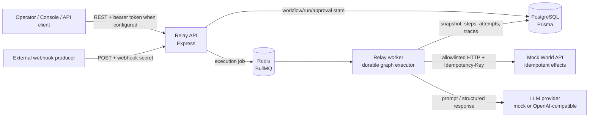

# Relay Project Overview and Design

## 1. Executive overview

Relay is a durable workflow orchestrator. An operator defines a directed graph of
deterministic and AI-enabled nodes, validates and publishes it, then starts a run
manually or through an authenticated webhook. The API stores workflow/run state in
PostgreSQL and dispatches execution through Redis/BullMQ. A background worker
executes nodes, persisting step results and traces so runs can be inspected and
resumed.

The local implementation uses Node.js and TypeScript, Express, Prisma,
PostgreSQL, Redis/BullMQ, Ajv JSON Schema validation, and a mock-world service
that demonstrates idempotent external side effects. An OpenAI-compatible provider
is available when credentials are configured. The browser console is served at
`/console`.

**Current deployment target:** local Docker Compose. Cloud hosting, a public
repository release, real-provider credentials, and an explainer video are
separate release deliverables; they are not implied by a successful local demo.

## 2. BRD alignment and delivery status

| BRD capability/deliverable | Current implementation/status |
|---|---|
| API, PostgreSQL, Redis queue, durable workers | Implemented in the local Compose stack |
| Workflow CRUD and publish validation | Drafts can be created/edited; graph is validated at publication |
| Webhook trigger with secret validation | Implemented; workflow must be published; secret hash is stored |
| Node-by-node execution and database persistence | Implemented, including run steps and traces |
| HTTP, condition, delay, notification, and AI nodes | Implemented |
| Idempotent external calls | Stable run/node key and cached successful response; mock service honors the key |
| Crash recovery | BullMQ retry/startup recovery; worker kill/restart was verified locally |
| JSON Schema validation for LLM results | Implemented for mock and OpenAI responses |
| Approval gates | Approval node and explicit pre-HTTP `requiresApproval` guard implemented |
| Mock world and execution traces | Implemented |
| Simple console | Implemented at `/console`, with workflow/run/approval operations and theme/responsive layouts |
| Automated backend checks | Worker unit tests and an opt-in local integration test are present |
| Local smoke/recovery evidence | Verified against the local Docker stack; see test and verification sections below |
| Production cloud deployment | Not completed; requires provider/account, secret provisioning, and deployment target |
| Real OpenAI demonstration | Not completed; requires a valid API key and user authorization to incur usage |
| Public GitHub repository | Not completed; destination repository and access are not configured |
| Demo video | Not completed; requires recording and delivery destination |

## 3. High-level architecture (HLD)



### Request and execution flow

1. An operator creates a draft workflow and may edit it while it remains a draft.
2. The operator publishes it. Relay validates node identifiers, edge targets, and
   protected-action configuration. A published workflow is immutable.
3. A manual run or authenticated webhook creates a `Run`, copies the workflow
   definition to `workflowSnapshot`, initializes run steps, and queues a job.
4. A worker loads the run snapshot and executes the graph, persisting step
   attempts/results and trace events.
5. A protected action or approval node creates a pending approval and moves the
   run to `WAITING_FOR_APPROVAL`. The worker yields rather than holding a worker
   slot while waiting.
6. An operator approves or rejects. Approval resumes the protected HTTP node;
   rejection cancels the run. A regular approval node advances to its configured
   next node on approval.
7. Terminal state and traces can be queried through the API and console.

## 4. Low-level design (LLD)

### 4.1 Services and responsibilities

| Component | Responsibility |
|---|---|
| `apps/api` | Workflow lifecycle, run and webhook triggers, approval decisions, REST API, static console |
| `apps/worker` | Queue consumption, graph traversal, node execution, retries, startup recovery, execution traces |
| `apps/mock-world` | Example downstream effect endpoint; persists mock effects by unique idempotency key |
| `packages/shared` | Shared workflow/run TypeScript contracts |
| Prisma/PostgreSQL | Durable workflow definitions, immutable run snapshots, runtime state, approvals, traces, idempotency records |
| Redis/BullMQ | Asynchronous execution jobs, retries, stalled-job handling |

### 4.2 Persistence model

| Entity | Important data | Purpose |
|---|---|---|
| `Workflow` | `status`, `publishedAt`, `nodes`, `maxSteps`, `webhookSecretHash` | Editable draft or immutable published graph; webhook secret is never returned |
| `Run` | `status`, `currentNodeId`, `stepsExecuted`, `createdInput`, `workflowSnapshot` | One execution, its trigger input, graph snapshot, and current state |
| `RunStep` | `nodeId`, `status`, `attempts`, `input`, `output`, timestamps | Per-node progress, retries, and materialized inputs/results |
| `Approval` | `runId`, `nodeId`, `status`, `decision`, `resolvedAt` | Durable human decision associated with a paused node |
| `Trace` | `runId`, `nodeId`, `event`, `payload`, `latencyMs`, `tokenCount` | Execution timeline and diagnostic evidence |
| `IdempotencyKey` | Unique `(runId, key)`, cached `response` | Reuses a successful external-call response when a node is retried |
| `MockEffect` | Unique `key`, stored response | Demonstrates downstream deduplication in Mock World |

### 4.3 Workflow and run state

Workflow lifecycle:

```text
DRAFT --publish after validation--> PUBLISHED
```

There is intentionally no unpublish/update-in-place transition. To change a
published definition, create a new draft workflow. Existing workflows were
migrated to `PUBLISHED` to preserve their prior runnable behavior.

Run lifecycle:

```text
QUEUED --> RUNNING --> SUCCEEDED
                   \-> FAILED
                   \-> WAITING_FOR_APPROVAL --> RUNNING (approved)
                                            \-> SUCCEEDED (approved final approval node)
                                            \-> CANCELLED (rejected)
```

`CANCELLED` is also the rejection outcome. Retries may re-enter `RUNNING`; the
worker uses persisted state/snapshots, step outputs, and idempotency records to
avoid redoing completed work where possible.

### 4.4 Node contracts

Each node has `id`, `type`, and `label`; optional `args` holds type-specific
configuration, and `nextNodeId` names the default next node. `condition` nodes
may instead select `args.onTrueNodeId` or `args.onFalseNodeId`.

| Type | Relevant `args` | Behavior |
|---|---|---|
| `notify` | `message` | Produces a notification/result payload; no external delivery integration is implied |
| `delay` | `ms` (0–30,000; default 100) | Waits for the configured interval |
| `condition` | `left`, `operator`, `right`, `onTrueNodeId`, `onFalseNodeId` | Evaluates `eq`, `neq`, `gt`, `gte`, `lt`, `lte`, `contains`, or `truthy` |
| `http_request` | `url`, `method`, `headers`, `body`, `timeoutMs`, `requiresApproval`, `approvalMessage` | Calls an allowlisted HTTP origin; supplies `Idempotency-Key`; rejects redirects |
| `llm` | `prompt`, `model`, `schema`, `mockResponse` | Calls configured mock/OpenAI provider and validates result against JSON Schema when supplied |
| `approval` | `message` | Pauses for an explicit approval decision and advances on approval |

Template roots are `{{input.path}}`, `{{steps.nodeId.output.path}}`, and
`{{previous.path}}`. A whole-string template preserves the referenced value's
type; interpolation inside a larger string is stringified.

### 4.5 HTTP API

All `/api` routes use `Authorization: Bearer <RELAY_API_TOKEN>` when an API token
is configured. Webhook authentication is separate and uses
`x-relay-webhook-secret`. In local development with no token, API bearer auth is
disabled.

| Method | Path | Purpose | Typical success |
|---|---|---|---|
| `GET` | `/health` | API liveness | `200` |
| `GET` | `/console` | Browser console | `200` HTML |
| `GET` | `/api/workflows` | List workflows | `200` |
| `GET` | `/api/workflows/:workflowId` | Read workflow | `200`; `404` if missing |
| `POST` | `/api/workflows` | Create draft | `201` |
| `PUT` | `/api/workflows/:workflowId` | Update draft | `200`; `409` for published |
| `POST` | `/api/workflows/:workflowId/publish` | Validate and publish draft | `200`; `400` invalid graph; `409` already published/race |
| `DELETE` | `/api/workflows/:workflowId` | Delete draft without run history | `204`; `409` for published/has runs |
| `POST` | `/api/workflows/:workflowId/run` | Queue a manual run | `202`; `409` if draft |
| `GET` | `/api/runs` | List runs with workflow/steps | `200` |
| `GET` | `/api/runs/:runId` | Read run, steps, traces, approvals | `200`; `404` if missing |
| `POST` | `/api/runs/:runId/approve` | Approve/reject current approval | `200`; `409` unless waiting |
| `POST` | `/api/webhooks/:workflowId` | Authenticated webhook trigger | `202`; `401` bad secret; `409` if draft |
| `GET` | `/health` on port `4101` | Mock World health and effect count | `200` |
| `GET` | `/mock/traces` on port `4101` | Inspect stored mock effects | `200` |

Create-workflow payload:

```json
{
  "name": "Protected payment demo",
  "description": "Demonstrates human approval before an external effect.",
  "maxSteps": 10,
  "webhookSecret": "replace-with-a-secret-at-least-16-chars",
  "nodes": [
    {
      "id": "payment",
      "type": "http_request",
      "label": "Create payment",
      "args": {
        "requiresApproval": true,
        "approvalMessage": "Approve payment for {{input.customer}}"
      }
    }
  ]
}
```

Run payload:

```json
{
  "trigger": "manual",
  "input": {
    "customer": "Demo Customer",
    "amount": 42
  }
}
```

Approval payload:

```json
{
  "approved": true,
  "message": "Approved for the demo"
}
```

### 4.6 Configuration and operating constraints

| Setting | Purpose |
|---|---|
| `DATABASE_URL` | PostgreSQL connection |
| `REDIS_URL` | Redis/BullMQ connection |
| `MOCK_WORLD_URL` | Default mock-world target |
| `HTTP_ALLOWED_ORIGINS` | Comma-separated HTTP(S) origins accepted by worker; defaults to the mock-world origin |
| `MAX_STEPS` | API maximum accepted workflow step limit |
| `RELAY_API_TOKEN` | Optional local bearer token; required for production-mode API startup |
| `LLM_PROVIDER` | `mock` or `openai` |
| `OPENAI_API_KEY`, `OPENAI_BASE_URL`, `OPENAI_MODEL` | Optional OpenAI-compatible provider configuration |
| `NODE_ENV` | Runtime mode; production API expects a strong bearer token |

Local Compose binds service ports to loopback. The included Compose credentials
are development-only. Before internet exposure, provision private database/Redis,
replace credentials, use HTTPS, and store API/LLM secrets in a secret manager.

**Delivery semantics:** Relay sends stable idempotency keys and caches successful
responses. The remote service must honor the key to deduplicate. A crash after an
arbitrary external service performs a side effect but before Relay records its
response can still repeat that effect if the external service does not implement
idempotency. This is not a global exactly-once guarantee.

**Network safety:** origin allowlisting and redirect rejection reduce accidental
outbound requests, but deployments should additionally enforce egress policy and
DNS/IP protections appropriate to their environment.

## 5. Use cases

| ID | Use case | Primary actor | Preconditions and outcome |
|---|---|---|---|
| UC-01 | Create and publish workflow | Operator | Create a draft; publish only after graph validation; published definition becomes immutable |
| UC-02 | Run workflow manually | Operator/API client | Workflow is published; API returns a queued run; worker executes from the persisted snapshot |
| UC-03 | Trigger from webhook | External producer | Workflow is published and has a webhook secret; valid secret queues a run; invalid secret receives `401` |
| UC-04 | Branch on data | Workflow author | Configure a condition and target IDs; engine evaluates supported operator and follows the configured graph route |
| UC-05 | Use AI with constrained output | Workflow author | Configure provider/prompt/JSON Schema; invalid output fails the step and does not advance graph routing |
| UC-06 | Protect a sensitive HTTP action | Operator/approver | Set `requiresApproval`; worker records pending approval and performs no HTTP request until approved |
| UC-07 | Reject a protected action | Approver | Run is waiting; rejection is persisted and run becomes `CANCELLED`; protected call does not execute |
| UC-08 | Recover interrupted execution | Platform operator | Worker or job interruption occurs; queue retry/startup recovery resumes durable work; idempotent downstream protects side effects |
| UC-09 | Diagnose a run | Operator | Query run details to inspect snapshot, steps, attempts, approvals, and traces |
| UC-10 | Bound looping workflows | Workflow author/operator | Configure `maxSteps`; a cycle exceeding the cap is failed with a trace event |

## 6. Test cases

### Automated tests

Run unit/build checks:

```powershell
npm run build
npm test
```

Run local integration coverage (requires the Compose stack, local database, API,
worker, and mock world):

```powershell
docker compose up --build -d
$env:RELAY_INTEGRATION_TESTS = "1"
npm test
```

| ID | Test case | Expected result | Current automated evidence |
|---|---|---|---|
| UT-01 | Resolve exact and interpolated templates | Values resolve from input, steps, and previous output | Worker unit test |
| UT-02 | Evaluate supported condition operators | Correct boolean route decision | Worker unit test |
| UT-03 | Reject unsupported condition operator | Explicit error | Worker unit test |
| UT-04 | Validate JSON Schema output | Matching value passes; invalid value throws | Worker unit test |
| UT-05 | Enforce HTTP allowed origins | Allowed origin accepted; disallowed/non-HTTP/credential URL rejected | Worker unit test |
| UT-06 | Reject allowlist entries with paths | Configuration error | Worker unit test |
| IT-01 | Draft cannot run; publish transitions to immutable | Draft run `409`; publish `200`; later edit/delete rejected | Opt-in API integration test |
| IT-02 | Run snapshot and approval message | Snapshot matches published graph; message template resolves | Opt-in API integration test |
| IT-03 | Protected side effect waits for approval | Zero mock effects before approval; one after approval | Opt-in API integration test |
| IT-04 | Webhook gate and secret | Draft trigger rejected; invalid secret `401`; valid secret queues and succeeds | Opt-in API integration test |
| IT-05 | Invalid mock LLM result | Run fails and includes `step_failed` trace | Opt-in API integration test |
| IT-06 | Step cap | Loop beyond `maxSteps` fails and includes `step_limit_exceeded` | Opt-in API integration test |

### Manual crash/recovery scenario

Verified locally against Compose: start a workflow with an idempotent HTTP node
followed by a long delay, kill the worker while the delay step is running, restart
the worker, and inspect the run. The run resumed to `SUCCEEDED`; Mock World
contained exactly one effect for that run. This demonstrates the tested mock
scenario, not exactly-once semantics for arbitrary remote systems.

### Additional recommended release checks

| ID | Test case | Expected result |
|---|---|---|
| REL-01 | Exercise real OpenAI provider with a non-production key | Valid structured output succeeds; invalid/timeout/provider errors are visible |
| REL-02 | Run production-mode API without `RELAY_API_TOKEN` | Startup fails safely |
| REL-03 | Call authenticated endpoints with missing/invalid bearer token | `401`; valid bearer succeeds |
| REL-04 | Configure external HTTP allowlist and redirect target | Allowed origin succeeds; unlisted origin and redirects fail |
| REL-05 | Deploy into target cloud environment | Health checks, private DB/Redis, secrets, migrations, and rollback validated |
| REL-06 | Record demo evidence/video | Deliverable stored in user-selected destination |

## 7. Demo walkthrough

1. Open `http://localhost:4000/console`.
2. Create or select a demo draft and publish it.
3. Start a run with representative input.
4. Open run details and show the immutable workflow snapshot and node state.
5. For a protected HTTP action, wait for `WAITING_FOR_APPROVAL`; inspect the
   pending approval and verify no effect is present in
   `http://localhost:4101/mock/traces`.
6. Approve and show the run reaching `SUCCEEDED` and the single mock effect.
7. Demonstrate webhook secret rejection/acceptance or an invalid AI schema.
8. For resilience evidence, show the previously verified worker kill/restart
   scenario and one stored mock effect.

## 8. Postman collection

Import [Relay_Local.postman_collection.json](../postman/Relay_Local.postman_collection.json)
into Postman. Set `baseUrl` and optionally `apiToken`. Run requests in the stated
order in the collection description. The collection captures workflow/run IDs
from successful responses. For the approval demo, repeat **Get run details** until
the returned state is `WAITING_FOR_APPROVAL`, then send **Approve run**.

## 9. Sequence and ER diagrams

See [Sequence and ER Diagrams](./SEQUENCE_AND_ER_DIAGRAMS.md) for the detailed
run/approval sequence, worker-recovery sequence, and Prisma entity relationships.

## 10. API specification

The Postman request collection is [Relay_Local.postman_collection.json](../postman/Relay_Local.postman_collection.json).
The matching OpenAPI 3.1 contract for Redocly is [openapi.yaml](../openapi.yaml),
registered by the repository's [redocly.yaml](../redocly.yaml).
