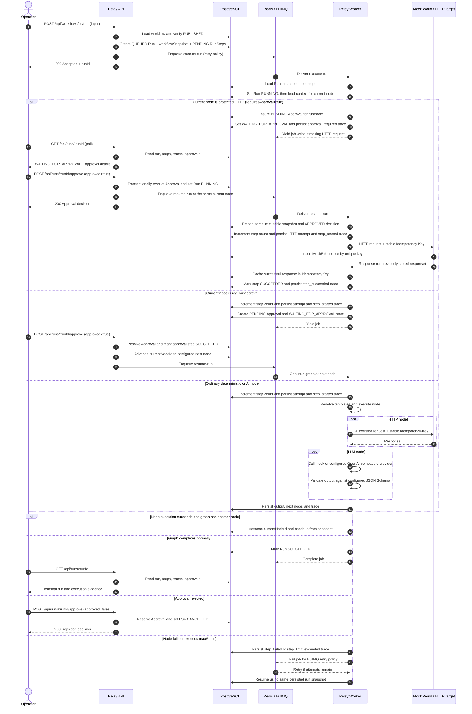
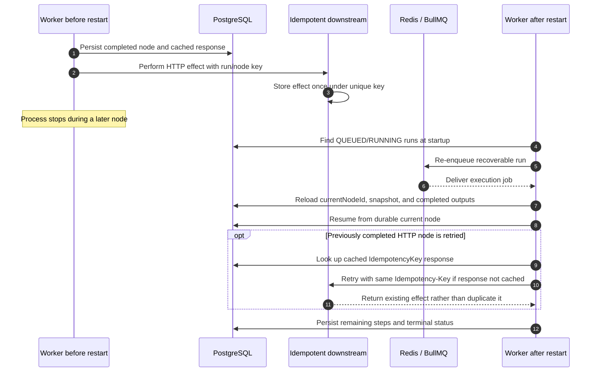
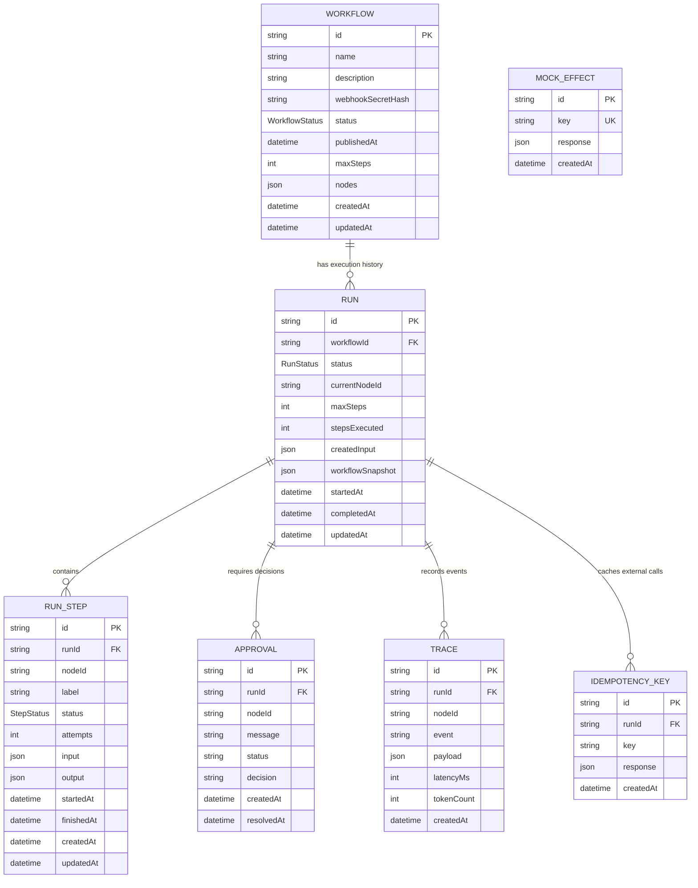

# Relay Sequence and ER Diagrams

These diagrams describe the current implementation: Express API, PostgreSQL via
Prisma, Redis/BullMQ, Relay worker, and Mock World. Mermaid diagrams render in
GitHub and compatible Markdown viewers.

## Workflow run and approval sequence

The main path below starts with an already published workflow. The optional
webhook trigger uses the same run creation, snapshot, and queue path after secret
validation.

### Recovery sequence

The idempotency guarantee depends on the downstream honoring the key. Relay
cannot guarantee exactly-once side effects with a remote service that ignores
idempotency keys, particularly if the remote effect happens before Relay stores
its response.

## Entity-relationship diagram

### Relationship and key notes

- Deleting a workflow cascades to its runs; deleting a run cascades to its steps,
  approvals, traces, and idempotency records.
- `RUN_STEP` is unique on `(runId, nodeId)`.
- `APPROVAL` is unique on `(runId, nodeId)`.
- `IDEMPOTENCY_KEY` is unique on `(runId, key)`.
- `MOCK_EFFECT.key` is globally unique in Mock World. It has no database foreign
  key to `RUN` or `IDEMPOTENCY_KEY`; it represents the downstream system's
  idempotency store.
- Workflow node edges and `RUN.currentNodeId`/node IDs are stored in JSON/scalar
  fields and are not relational foreign keys.
